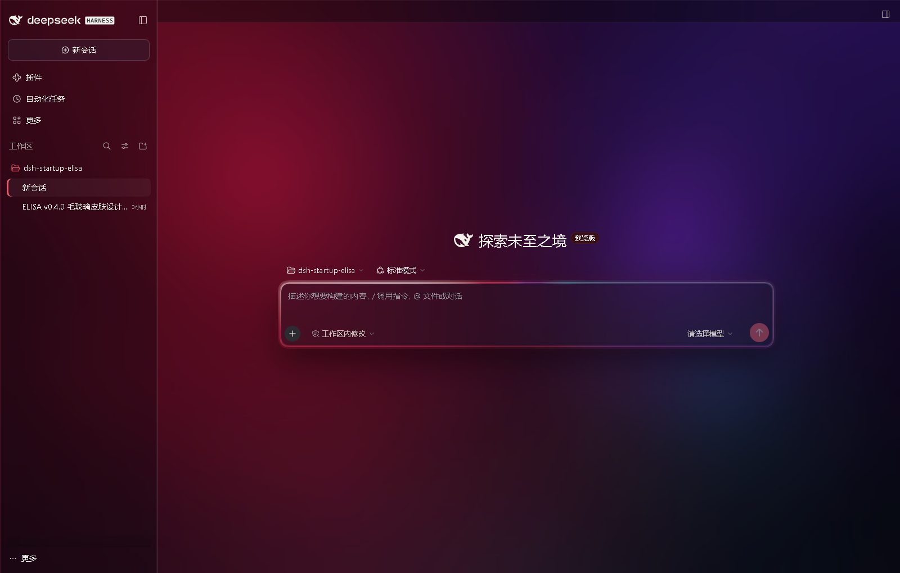
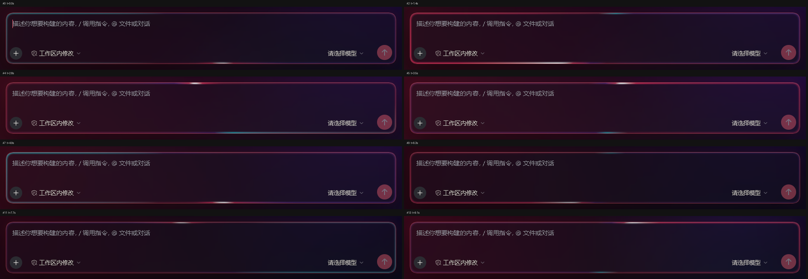

# dsh-startup-elisa

[](https://github.com/QIFANAI/dsh-startup-elisa/actions/workflows/test.yml)
[](LICENSE)

DeepSeek Harness（DSH）的**冷启动动画 + 客户端皮肤**插件：DSH 黑幕开幕 → ELISA 冷启动
HUD → 设计化交接转场 → 主界面毛玻璃皮肤。音轨全部由本项目程序化合成。

当前版本 **0.6.0（代号 FLOW）**，web profile 与 DeepSeek Harness Desktop 通用，
零运行时依赖。

> 本仓库**不包含第三方人物素材**（Wallpaper Engine 工坊场景渲染的 ELISA 视频/海报/图层）。
> 没有素材时插件按降级链继续运行；想还原完整观感，请按
> [lib/assets/README.md](lib/assets/README.md) 自备**你有权使用**的素材。
> 授权边界见 [THIRD-PARTY-NOTICES.md](THIRD-PARTY-NOTICES.md)。



## 效果

- **启动动画（7.2s 动画契约，按 `splashSpeed` 换算墙钟）**：黑幕开幕 → HUD 逐项锁定
  （PROFILE / MODEL / BUNDLES / SANDBOX / SESSIONS）→ 粒子与光扫 → 幕布合拢到绯红光缝
  → 主界面「通电」显影。默认 80% 速度，总墙钟 9.0s。
- **交接转场**：不是黑场硬切。幕布合拢 → 光缝增亮展开 → 通电扫描 → 宿主 UI 交叉显影；
  速度与交接时长同一套公式换算。
- **音轨**：`scripts/make-audio.py` 程序化合成的 7.8s 主声轨（19 个 cue）+ 1.35s chime；
  自动播放被拦时静音降级，首次手势从当前进度补播；变速时音高不变。
- **四档皮肤**：`off` / `accent` / `full` / **`glass`（默认）**。
- **glass 档**：整窗 `backdrop-filter` 毛玻璃 + 动态主题背景（11 个子层，8.4s 呼吸 v2）
  + 可调通透度 + 三套主题（aurora / deepsea / violet）+ 输入框整圈流动光边框
  （1.6px 主题环 + 8s 旋转 conic 光场 + 相位锁定外缘泛光）。
- **可调**：启动速度 50–150%、玻璃通透度 0–100、动态背景开关、减弱动态、声音与音量；
  设置页「ELISA 启动动画」内嵌预览与试听。

| 输入框整圈流动光边框（8 个相位） |
|---|
|  |

## 安装

### 方式一：Release 安装包（推荐）

从 [Releases](https://github.com/QIFANAI/dsh-startup-elisa/releases) 下载
`dsh-startup-elisa-0.6.0.tgz` 与 `SHA256SUMS`，**完全退出 DSH**（含托盘）后：

```bash
dsh plugin --profile desktop add ./dsh-startup-elisa-0.6.0.tgz
dsh plugin --profile desktop list
```

web profile 将 `desktop` 换成 `web`。若 `dsh` 不在 PATH，用 DSH 安装目录下的
`resources/runtime/cli/bin/dsh.cmd`。

也可以让脚本下载、校验并安装（Node 20+，不执行远程脚本）：

```powershell
Invoke-WebRequest -Uri "https://raw.githubusercontent.com/QIFANAI/dsh-startup-elisa/v0.6.0/scripts/install.mjs" -OutFile install-elisa.mjs
node install-elisa.mjs --profile desktop --version 0.6.0 --dry-run
node install-elisa.mjs --profile desktop --version 0.6.0
```

### 方式二：从源码构建

```bash
git clone https://github.com/QIFANAI/dsh-startup-elisa.git
cd dsh-startup-elisa
npm test           # 497 项冒烟（素材缺失时会跳过/改验优雅 404）
npm run build      # 只打包 git 已跟踪文件 → releases/dsh-startup-elisa-0.6.0.tgz
dsh plugin --profile desktop add ./releases/dsh-startup-elisa-0.6.0.tgz
```

无素材构建出的包同样可安装：启动层走静帧降级，皮肤与设置全部可用。

## 配置

配置文件 `~/.dsh/dsh-startup-elisa.json`（缺省自动补默认）：

```json
{
  "enabled": true,
  "mode": "session",
  "allowSkip": true,
  "reducedMotion": false,
  "sound": true,
  "volume": 65,
  "skin": "glass",
  "skinTheme": "aurora",
  "skinMotion": true,
  "glassTransparency": 50,
  "splashSpeed": 80
}
```

| 键 | 取值 | 说明 |
|---|---|---|
| `enabled` | `true` / `false` | 总开关 |
| `mode` | `session` / `daily` / `always` | 每个会话一次 / 每天一次 / 每次打开 |
| `allowSkip` | `true` / `false` | 关闭后隐藏跳过按钮，Esc 与点击跳过同时禁用 |
| `reducedMotion` | `true` / `false` | 静态终帧 + 300ms 简短交接；**默认不跟随系统**，只有显式 `true` 才生效 |
| `sound` / `volume` | 布尔 / 0–100 | 音效与音量 |
| `skin` | `off` / `accent` / `full` / `glass` | 皮肤档位；默认为 `glass` |
| `skinTheme` | `aurora` / `deepsea` / `violet` | glass 档主题背景 |
| `skinMotion` | `true` / `false` | 动态背景/流光开关；`reducedMotion=true` 时强制静态 |
| `glassTransparency` | 0–100 | 玻璃通透度；50 = 标准，越大越透；保存立即生效 |
| `splashSpeed` | 50–150 | 启动动画速度百分比；100 = 原速；保存后下次启动生效 |

- 外观类（皮肤/主题/动态背景/通透度）**保存立即生效**；启动类（速度/声音/时机）
  **下次启动生效**。
- 同一 profile 只能启用一个启动插件；与 nostromo / yomi / screen 等互斥。

## 离线预览

直接用 Edge / Chrome 打开 `preview/index.html`，无需 DSH：

```text
file:///<仓库路径>/preview/index.html
```

查询参数：`?speed=80`（50–150）、`?t=2.8`（冻结到动画秒）、`?freezeAnim=130`（冻结 CSS 动画毫秒）、
`?reduced=1`、`?allowSkip=0`、`?autoskip=2`、`?sound=0`、`?volume=0..100`、`?probe=1`。
无素材时自动走 `no-video` 静帧分支，时间轴照常推进。

## 目录结构

```text
.
├─ lib/                 插件运行时：index.js(Host) / splash.js / splash.css /
│                       audio.js / skin.css / client.js / assets/
├─ preview/index.html   离线预览舞台（?embed=1 接真实宿主）
├─ test/                五套冒烟：host / splash+audio / speed / client / skin
├─ scripts/             make-audio.py / build-release.mjs / check-public.mjs /
│                       install.mjs / make-combo-package.ps1
├─ combo/               「拖进对话框即装」组合包源文件（给 DSH 代理读的安装说明 +
│                       安装/核验脚本；组合包由 scripts/make-combo-package.ps1 组装）
├─ docs/                设计规格、独立评审、QA 报告、历史验收记录与截图
├─ .github/             CI、Issue/PR 模板
├─ release.json         当前 Release 的版本 / 大小 / SHA-256 / 下载地址
└─ THIRD-PARTY-NOTICES.md
```

## 构建与验收

```bash
npm test                 # 497 项冒烟
npm run check            # 公开仓库门禁：本机路径 / 凭据 / 媒体文件 / 版本一致性
npm run build            # 可复现 source 包 → releases/*.tgz + SHA256SUMS
npm run verify:release   # 重建并与 release.json 比对
```

设计文档：`docs/design/design-spec-v6.md`（v0.6 唯一权威源）、`docs/design/review-v1.md`、
`docs/design/review-v2.md`、`docs/verify/qa-report-v6.md`（30 项矩阵），
历史版本记录在 `docs/history/P2…P8`。

## 兼容与已知限制

- 目标宿主：DeepSeek Harness `0.2.1-rc.5` 及同 API 版本；Windows 11 + Electron desktop / web。
- `glass` 档固定深色语义：宿主切浅色时玻璃界面仍按深色渲染，避免深色玻璃上深色文字不可读。
- `backdrop-filter` 元素数 ≤ 3；不支持的环境自动降级为高不透明度磨砂；远程桌面/无 GPU 同理。
- **性能已知风险**：软光栅口径下 v0.6 的 `TaskDuration` 较 v0.5 上升约 173%
  （背景呼吸层 + composer 伪元素动画）；GPU 合成实测 FPS 86–87、无持续掉帧，
  Electron 实机流畅度与功耗仍待更多机器确认。可回退：关闭「动态背景」、切 `full` 档。
- 高 DPI / 4K、`--noblur`、`prefers-reduced-motion` 之外的低配降级路径未单独截图核对。
- 完整验收矩阵与未验证项见 [docs/verify/qa-report-v6.md](docs/verify/qa-report-v6.md)。

## 授权

代码以 [MIT](LICENSE) 发布。第三方人物素材不在 MIT 范围内、不随仓库分发；
程序化音频随代码授权。详见 [THIRD-PARTY-NOTICES.md](THIRD-PARTY-NOTICES.md)。
